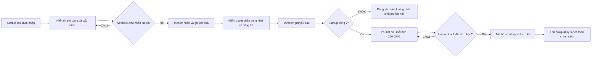

# Rà soát trang và luồng nghiệp vụ 2G2BT

Ngày rà soát: 10/11/2026. Đây là bản kiểm tra code và giao diện đang chạy tại `127.0.0.1:5180`, chưa phải xác nhận sẵn sàng production.

## Phạm vi đã kiểm tra

- Bản máy chủ và `?mode=demo`, với vai trò Startup và Investor.
- Investor: AI Chat, Dashboard, Phân tích tài chính, Marketplace và hồ sơ startup, Case, Workspace, Thẩm định, Danh mục, Hợp tác, Tài liệu, Giá, Hỗ trợ, Quyền riêng tư.
- Startup: Trang chủ, Trò chuyện, Quản lý startup, Phân tích tài chính, Workspace và các tab, Case, Giá, Quyền riêng tư.
- Desktop 1280px; mobile 390px ở cả Light và Dark. Kiểm tra lỗi JavaScript, tràn ngang, trang rỗng, nút không có tên truy cập và hướng đi từ sidebar.
- Kiểm thử tự động: build, unit, server, luồng E2E máy chủ và E2E demo.

Kết quả lượt rà soát 10/11: build đạt; 61 unit test đạt; 73 server test đạt, 1 bỏ qua vì máy không hỗ trợ symlink; 8 E2E máy chủ và 28 E2E demo đạt. Sau khi bỏ ảnh và người tự dựng, đã chạy lại build và các E2E liên quan đến đội ngũ/case. Ngày 11/11, phần case máy chủ được bổ sung và kiểm thử lại riêng.

## Sai lệch đã sửa trong lượt này

| Trang | Trước | Sau |
|---|---|---|
| Investor → Case & kết nối, bản máy chủ | Link mở nhầm Dashboard vì chưa có route Case trên máy chủ | Có trang Case thật: khi chưa có case đủ điều kiện công bố, Investor thấy trạng thái chờ và đường về Marketplace |
| Startup → Quản lý startup, bản máy chủ | Hiển thị Marketplace dành cho Investor, gồm lời mời xin quyền | Hiển thị các hồ sơ thuộc Startup, trạng thái công bố và đường vào quản lý |
| Startup → Gói dịch vụ, bản máy chủ | Hiển thị gói thuê bao tháng Startup trái với quy tắc phí theo case | Hiển thị phí theo case, giá đăng chưa chốt, phí kết nối 500.000đ chia đều sau khi đồng ý và link tới trang Case đang hoạt động |
| Quyền riêng tư | Mô tả gói Startup và token theo cách dễ hiểu là khoản thu theo lượt | Nêu rõ token chỉ để quản lý tài nguyên, thanh toán hiện chưa mở |
| E2E máy chủ | Một số nhãn cũ làm bài kiểm thử sai dù UI đã đổi | Đồng bộ kỳ vọng theo nội dung và quy tắc giá hiện tại |
| Quyền xem hồ sơ riêng | Startup đồng ý là mở ngay CSV, báo cáo và trao đổi | Máy chủ giữ khóa cho đến khi ghi nhận đúng hai khoản 250.000đ; mã giao dịch trùng, sai số tiền và xác nhận từ trình duyệt đều bị từ chối. Giao diện cho biết bên nào còn chờ. |
| Đội ngũ trên case thử | Tên người và ảnh tự dựng được gắn vào hồ sơ như người thật | Bỏ tự ghép chân dung theo tên và bỏ nhóm nhân sự dựng sẵn khỏi case; dữ liệu đội ngũ chỉ hiện khi Startup nhập. Dọn các trường đội ngũ và số liệu sử dụng không có nguồn ở ba hồ sơ local, giữ bản sao trước khi dọn trong `.runtime/workflow-pre-audit-2026-11-10.json`. |
| Case trên máy chủ (11/11) | Chỉ có luồng trong trình duyệt ở bản demo | Startup tạo case nháp, gửi sang trạng thái chờ cấu hình phí, rút về sửa; trạng thái lưu bền vững. Investor không thấy case chờ. Trình duyệt không có thao tác tự xác nhận thanh toán hoặc mentor. |

## Các chốt nghiệp vụ còn thiếu trên bản máy chủ

1. **Case máy chủ đang dừng ở trạng thái chờ.** Bản máy chủ đã lưu nháp và trạng thái chờ cấu hình phí, nhưng chưa có bước thanh toán, giao mentor, công bố và kết nối theo từng case. Chốt phí kết nối hiện áp dụng cho yêu cầu xem workspace riêng.
2. **Xác nhận phí đang chờ cổng thanh toán.** Store có phương thức nội bộ ghi biên nhận 250.000đ từng bên, chống ghi trùng và khóa quyền đến khi đủ hai bên. Chưa có webhook được xác thực, nên người dùng không thể thanh toán và mở quyền bằng UI hiện tại.
3. **Mentor chưa có danh tính và quyền hạn riêng.** Trong demo, Startup có thể bấm tạo đầu ra mentor mẫu. Không được coi đây là kết quả mentor thật.
4. **Thanh toán chưa thể kích hoạt.** Phí đăng case chưa chốt; chưa có cổng thanh toán, webhook xác nhận, biên nhận cho người dùng và chính sách hủy/hoàn tiền. Không được mở quyền dựa vào nút xác nhận ở trình duyệt.
5. **Vai trò hiện vẫn là tài khoản thử.** Có thể đổi Startup/Investor từ cùng trình duyệt; chưa có đăng nhập và định danh cho production.
6. **Hạn mức Startup trong máy chủ vẫn dựa trên gói nội bộ.** Giao diện giá đã theo case, nhưng `change-plan` và giới hạn workspace/token cũ vẫn còn trong store. Cần chuyển quy tắc sử dụng trước khi thu tiền.
7. **Tài liệu thẩm định mới có CSV và câu trả lời văn bản.** Pitch deck, bằng chứng, quyền theo tệp và nhật ký xem tệp chưa có.
8. **Ba hồ sơ LotusPay, Verda, MedFlow vẫn là dữ liệu thử ở môi trường local.** Tên startup, mục tiêu gọi vốn và mô tả khái quát chưa có hồ sơ nguồn được xác nhận. Không được xuất bản các hồ sơ đó như dữ liệu thật khi lên production.
9. **Hiệu năng tải trang cần tối ưu trước production.** Bản build hiện có JavaScript chính khoảng 567 KB trước nén; Vite báo vượt ngưỡng 500 KB. Ảnh chân dung tự dựng đã được loại khỏi bundle, còn việc tách tải theo trang có thể làm sau khi chốt luồng.

## Luồng chuẩn cần nối lên máy chủ

**Quy tắc chốt:** Customer là Investor; Investor giữ subscription. Startup trả phí cố định mỗi case (mức chưa chốt). Phí kết nối 500.000đ tổng, chia đều sau khi Startup đồng ý. AI không thu thêm theo lượt từ người dùng. Không dùng đầu ra AI thay cho mentor.

**Điều kiện còn cần từ chủ sản phẩm:** mức phí đăng case, cổng thanh toán, mentor nội bộ hay đối tác và người được duyệt công bố, chính sách hủy/hoàn tiền. Có thể triển khai state machine và API khóa quyền trước; bước thu tiền thật cần các quyết định này.

**Lưu ý dữ liệu cũ:** yêu cầu từng được đánh dấu `approved` nhưng không có biên nhận sẽ được giữ để đối soát, song không còn mở hồ sơ riêng. Cần đối chiếu thủ công trước khi nhập biên nhận hợp lệ hoặc xử lý hoàn/hủy.
