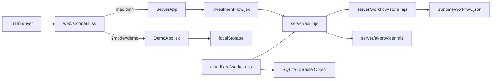
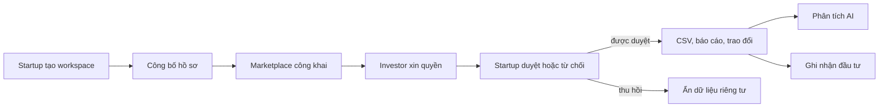

# Bản đồ project 2G2BT

**Tìm nhanh:** mở [sơ đồ tệp có ô tìm kiếm](PROJECT-GRAPH.html), gõ tên chức năng hoặc tệp, rồi bấm một nút để mở source. Sơ đồ cho biết tệp đang import và được import bởi những tệp nào. Chạy `node tools/build-project-graph.mjs` từ thư mục gốc repo sau khi thêm hoặc đổi import.

## Hai nhánh chạy của ứng dụng

| Chạy ở đâu | Điểm vào | Dữ liệu |
| --- | --- | --- |
| Local dev/preview | [`web/vite.config.js`](../web/vite.config.js) gắn API vào Vite | [`web/server/workflow-store.mjs`](../web/server/workflow-store.mjs) lưu `.runtime/workflow.json` |
| Render/Node production | [`web/server/start.mjs`](../web/server/start.mjs) phục vụ `web/dist` và API | Cùng workflow store, file theo `WORKFLOW_DATA_FILE` hoặc mặc định `.runtime/workflow.json` |
| Cloudflare | [`web/cloudflare/worker.mjs`](../web/cloudflare/worker.mjs) gọi cùng API | [`web/cloudflare/sqlite-snapshot.mjs`](../web/cloudflare/sqlite-snapshot.mjs) trong Durable Object |
| `?mode=demo` | [`web/src/DemoApp.jsx`](../web/src/DemoApp.jsx) | `localStorage` qua [`web/domain.js`](../web/domain.js), [`web/src/demoAccounts.js`](../web/src/demoAccounts.js), [`web/src/caseWorkflow.js`](../web/src/caseWorkflow.js) |

**Lưu ý khi sửa:** trang mặc định và `?mode=demo` có thể trông giống nhau nhưng xử lý dữ liệu khác nhau. Kiểm tra URL và vai trò Startup/Nhà đầu tư trước khi chọn tệp.

## Chọn tệp theo trang

Định tuyến hash `#/...` nằm trong [`web/src/main.jsx`](../web/src/main.jsx) và [`web/src/DemoApp.jsx`](../web/src/DemoApp.jsx). `#/dashboard` được chuyển về `#/home`; `#/home/:id` được chuyển sang `#/conversations/:id`.

| Trang hoặc tính năng | Bản mặc định (API) | `?mode=demo` |
| --- | --- | --- |
| Trang chủ `#/home` | [`HomePage.jsx`](../web/src/HomePage.jsx), [`InvestorPages.jsx`](../web/src/InvestorPages.jsx), `main.jsx` | Cùng component, ghép tại `DemoApp.jsx` |
| AI Chat `#/conversations` của investor | [`InvestorAIChat.jsx`](../web/src/InvestorAIChat.jsx), [`server/api.mjs`](../web/server/api.mjs) | `InvestorAIChat.jsx`, [`DemoAIAgent.jsx`](../web/src/DemoAIAgent.jsx) |
| Hội thoại cá nhân `#/conversations/:id` | [`ConversationsPage.jsx`](../web/src/ConversationsPage.jsx), [`conversations.js`](../web/src/conversations.js) | Cùng component và dữ liệu trình duyệt |
| Marketplace `#/marketplace` | [`InvestmentFlow.jsx`](../web/src/InvestmentFlow.jsx), [`DiligenceSections.jsx`](../web/src/DiligenceSections.jsx) | `Marketplace` trong `DemoApp.jsx` |
| Hồ sơ startup `#/startup/:id` | `InvestmentFlow.jsx`, `DiligenceSections.jsx`, [`TeamRoster.jsx`](../web/src/TeamRoster.jsx) | `StartupDetail` trong `DemoApp.jsx` |
| Workspace `#/workspace/:id` | `InvestmentFlow.jsx`, `TeamRoster.jsx` | [`ProjectPages.jsx`](../web/src/ProjectPages.jsx) |
| Phân tích `#/analysis` | `InvestmentFlow.jsx`, [`UsageUI.jsx`](../web/src/UsageUI.jsx) | `UsageUI.jsx` |
| Danh mục `#/portfolio` | `InvestmentFlow.jsx` | `ProjectPages.jsx` |
| Gói/phí `#/pricing` | [`PlansPage.jsx`](../web/src/PlansPage.jsx) | `PlansPage.jsx` hoặc [`CasePricingPage.jsx`](../web/src/CasePricingPage.jsx) cho Startup |
| Case & kết nối `#/cases` | Chưa có nhánh trang riêng trong `main.jsx` | [`CaseWorkflowPage.jsx`](../web/src/CaseWorkflowPage.jsx), `caseWorkflow.js` |
| Sidebar Startup / Investor | [`StartupSidebar.jsx`](../web/src/StartupSidebar.jsx) / [`InvestorSidebar.jsx`](../web/src/InvestorSidebar.jsx) | Dùng lại cùng hai component |
| Giao diện sáng/tối, logo | [`ThemeToggle.jsx`](../web/src/ThemeToggle.jsx), [`Brand.jsx`](../web/src/Brand.jsx), [`index.css`](../web/src/index.css) | Dùng lại cùng component/style |

## Luồng nghiệp vụ chính

Giao diện gọi `/api/demo/session` để lấy phiên, `/api/workflow` để lấy snapshot, rồi `/api/workflow/actions` để thực hiện hành động. [`web/server/api.mjs`](../web/server/api.mjs) kiểm phiên và chuyển đến [`web/server/workflow-store.mjs`](../web/server/workflow-store.mjs), nơi xử lý `create-workspace`, `publish`, `request-access`, `decide-access`, `upload-financial`, `update-diligence`, `send-message`, `record-investment` và `update-investment`. `/api/ai/analysis` và `/api/ai/chat` đi qua [`web/server/ai-provider.mjs`](../web/server/ai-provider.mjs).

## Tìm theo vấn đề

| Nếu muốn sửa… | Bắt đầu tại |
| --- | --- |
| Route mở sai trang, logo về sai chỗ | `main.jsx` / `DemoApp.jsx` (`routeFromHash`, `navigate`), rồi `Brand.jsx` |
| Sidebar của một vai trò | `StartupSidebar.jsx` / `InvestorSidebar.jsx` |
| Thẻ startup, biểu đồ, thông tin đội ngũ | `InvestmentFlow.jsx`, `DiligenceSections.jsx`, `TeamRoster.jsx` |
| Xin/duyệt/thu hồi quyền, CSV, dữ liệu riêng tư | `InvestmentFlow.jsx` → `server/api.mjs` → `server/workflow-store.mjs` |
| AI Chat, token, lỗi provider | `InvestorAIChat.jsx` / `AIAgent.jsx` → `server/api.mjs` → `server/ai-provider.mjs` |
| Gói và giá | `PlansPage.jsx`, `CasePricingPage.jsx`, `domain.js`, [`docs/GOI-DICH-VU.md`](GOI-DICH-VU.md) |
| Chỉ lỗi khi deploy | `server/start.mjs`, `cloudflare/worker.mjs`, [`docs/HOST-RENDER.md`](HOST-RENDER.md), [`docs/HOST-CLOUDFLARE.md`](HOST-CLOUDFLARE.md) |
| Kiểm thử | [`web/tests`](../web/tests), [`web/server`](../web/server), [`tools`](../tools) |

Sơ đồ HTML chỉ biểu diễn **import tĩnh** giữa tệp source; các cạnh `fetch`, lưu trữ, định tuyến và thao tác người dùng được mô tả ở tài liệu này.
